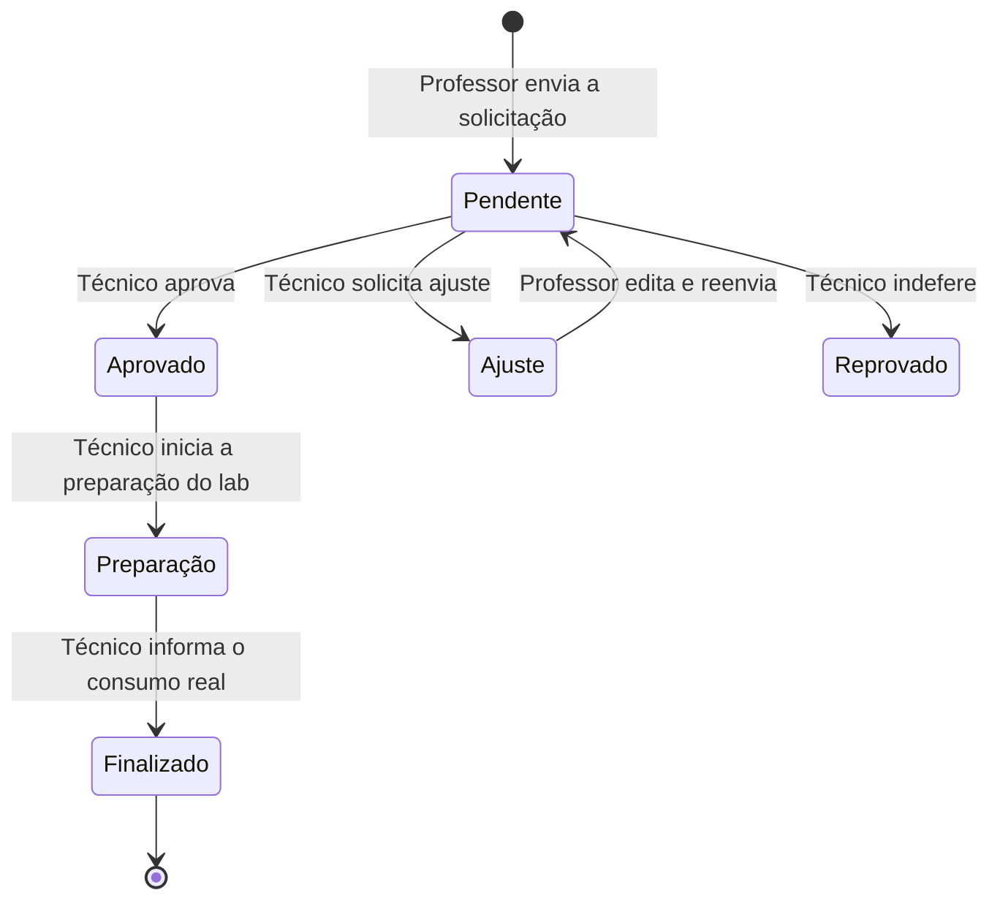
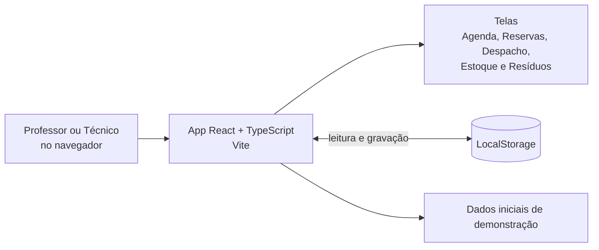
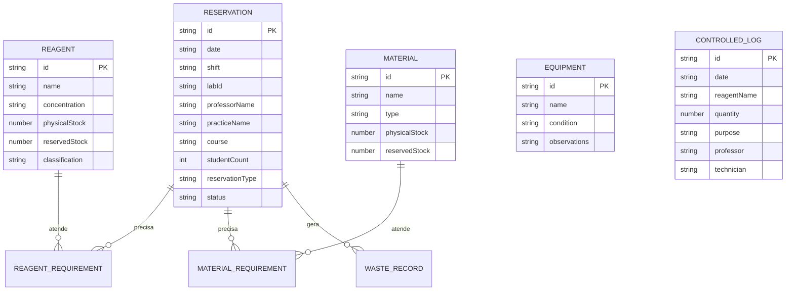

# IFLab

> MVP para organizar os laboratórios de Química e Biologia do campus: agendamento de aulas práticas, controle de reagentes, materiais e equipamentos, gestão de resíduos e acompanhamento das solicitações.


**Demo online:** https://remix-labflow.ai.studio/

## Sumário

- [Visão geral](#visão-geral)
- [Sobre o hackathon](#sobre-o-hackathon)
- [Funcionalidades](#funcionalidades)
- [Fluxo de uma reserva](#fluxo-de-uma-reserva)
- [Regras de negócio](#regras-de-negócio)
- [Arquitetura](#arquitetura)
- [Modelo de dados](#modelo-de-dados)
- [Pré-requisitos](#pré-requisitos)
- [Configuração e execução local](#configuração-e-execução-local)
- [Estrutura do projeto](#estrutura-do-projeto)
- [Observações técnicas e limitações](#observações-técnicas-e-limitações)
- [Autor](#autor)

## Visão geral

A rotina de aulas práticas em laboratórios de Química e Biologia envolve muitas etapas: o professor precisa reservar o espaço, listar reagentes, vidrarias e equipamentos, e prever os resíduos que a aula vai gerar. Do outro lado, o técnico precisa conferir o estoque, preparar as bancadas e registrar o que foi realmente consumido. Quando isso é feito por conversas informais e papel, falta rastreabilidade.

O IFLab foi idealizado para integrar o fluxo de trabalho entre **professores** e **técnicos de laboratório**. O professor solicita a reserva já com o planejamento da prática; o técnico avalia, prepara o laboratório, finaliza a aula com os consumos reais e controla os resíduos gerados.

## Sobre o hackathon

O projeto foi desenvolvido durante o **Hackathon do evento CODIFICA**, organizado pelo **IFPR, Campus Cascavel**, em **dois dias** de maratona. A equipe conquistou o **3º lugar**.

Por ter sido construído nesse prazo, o IFLab é um **MVP**: demonstra o fluxo completo de ponta a ponta com dados de exemplo, mas ainda não possui back-end nem autenticação (veja [Observações técnicas e limitações](#observações-técnicas-e-limitações)). O desenvolvimento foi feito em equipe, com auxílio do **Google AI Studio**, explorando ferramentas de inteligência artificial como apoio à prototipação e ao desenvolvimento de software.

## Funcionalidades

A aplicação simula dois perfis, que podem ser alternados no cabeçalho: **Professor** e **Técnico**.

| Perfil | Área | O que é possível fazer |
| --- | --- | --- |
| Ambos | **Agenda e Turnos** | Calendário mensal por laboratório (Laboratório 1, 2 e 3), com visualização das ocupações por turno, histórico de aulas e atalho para **repetir uma prática** já realizada. |
| Professor | **Solicitação de reserva** | Formulário em quatro etapas: dados da turma, reagentes, materiais e equipamentos, e planejamento de resíduos esperados. Permite anexar o roteiro de prática (PDF) e cadastrar novos reagentes ou materiais na hora. |
| Professor | **Meus Agendamentos** | Lista das solicitações com filtro por status e por laboratório, e opção de editar e reenviar quando o técnico pede ajustes. |
| Técnico | **Despacho Técnico** | Fila de solicitações para **aprovar**, **solicitar ajuste** ou **indeferir**, além do mapa de preparação de bancadas e da finalização da prática com o consumo real. |
| Técnico | **Almoxarifado e Estoque** | Gerenciamento de reagentes, materiais e equipamentos, com estoque físico, estoque reservado e classificação de controle legal. |
| Técnico | **Gestão de Resíduos** | Custódia acumulada por tipo de resíduo, histórico catalogado, marcação de coleta e solicitação de coleta especial ao campus. |

## Fluxo de uma reserva



Ao finalizar a prática, o técnico registra as quantidades **realmente** usadas de reagentes e materiais e os resíduos gerados. Nesse momento o estoque físico é atualizado e os resíduos entram na custódia do almoxarifado.

## Regras de negócio

- **Turnos:** manhã (08:00 às 12:00), tarde (14:00 às 18:00) e noite (19:00 às 22:30).
- **Antecedência mínima:** reservas só podem ser feitas com pelo menos **48 horas** de antecedência em relação ao início do turno, e não é possível reservar datas passadas.
- **Capacidade:** até **45 alunos** por turma.
- **Tipos de reserva:**
  - **Aula integral:** bloqueia o laboratório inteiro no turno.
  - **Projeto:** reserva por **bancada** (de 1 a 3); cada bancada aceita apenas um projeto por turno.
- **Conflitos:** uma aula integral não pode ser marcada se já houver qualquer reserva no mesmo turno, e um projeto não pode ser marcado em um turno com aula integral ou em uma bancada já ocupada.
- **Estoque reservado:** reservas aprovadas ou em preparação reservam automaticamente as quantidades de reagentes e materiais. O formulário avisa quando o necessário excede o **estoque livre** (físico menos reservado).
- **Baixa de estoque:** o estoque físico só diminui quando o técnico finaliza a prática e confirma o consumo.
- **Reagentes controlados:** cada reagente é classificado como comum, controlado pela **Polícia Federal** ou controlado pelo **Exército**. Ao finalizar uma prática, reagentes controlados pela PF geram automaticamente um **registro de controle** (data, quantidade, finalidade, resíduo, professor e técnico).
- **Resíduos:** classificados em orgânico, inorgânico, inflamável, oxidante e biológico, com quantidade prevista pelo professor e quantidade real informada pelo técnico, incluindo o método de descarte.
- **Edições:** qualquer alteração em uma solicitação volta o status para pendente, para nova avaliação do técnico.

## Arquitetura



Toda a aplicação roda no navegador. O estado principal (reagentes, materiais, equipamentos, reservas e registros controlados) fica centralizado no componente `App`, é distribuído para as telas por props e é gravado no **LocalStorage** a cada alteração. Na primeira abertura, os dados vêm de `src/data/initialData.ts`.

### Tecnologias

- **Interface:** React 19, TypeScript e Vite.
- **Estilo:** Tailwind CSS 4.
- **Ícones e animações:** lucide-react e motion.
- **Persistência:** LocalStorage do navegador.
- **Apoio ao desenvolvimento:** Google AI Studio.

## Modelo de dados



Os tipos completos estão em `src/types.ts`. As reservas guardam os equipamentos necessários como uma lista de IDs de `EQUIPMENT`, por isso a relação não aparece como entidade própria no diagrama.

## Pré-requisitos

- Node.js e npm.

## Configuração e execução local

### 1. Clone o repositório

```bash
git clone https://github.com/LucasIberDias/IFLab.git
cd IFLab
```

### 2. Instale as dependências

```bash
npm install
```

### 3. Inicie a aplicação

```bash
npm run dev
```

A aplicação sobe em `http://localhost:3000`. Não é necessário configurar variáveis de ambiente para executar o front-end: o arquivo `.env.example` é um resquício do modelo do Google AI Studio.

### Scripts disponíveis

| Comando | Finalidade |
| --- | --- |
| `npm run dev` | Inicia o servidor de desenvolvimento do Vite na porta 3000. |
| `npm run build` | Gera o build de produção. |
| `npm run preview` | Serve localmente o build gerado. |
| `npm run lint` | Verifica os tipos com o TypeScript (`tsc --noEmit`). |
| `npm run clean` | Remove a pasta `dist`. |

## Estrutura do projeto

```text
IFLab/
├── index.html
├── package.json
├── vite.config.ts
├── tsconfig.json
├── metadata.json
├── .env.example
└── src/
    ├── App.tsx               # Estado global, persistência e regras de fluxo
    ├── main.tsx
    ├── index.css
    ├── types.ts              # Tipos de reservas, reagentes, materiais e resíduos
    ├── components/
    │   ├── RoleSelector.tsx      # Alternância entre Professor e Técnico
    │   ├── CalendarView.tsx      # Agenda mensal por laboratório
    │   ├── ReservationForm.tsx   # Solicitação de reserva e planejamento
    │   ├── MyReservationsView.tsx# Acompanhamento do professor
    │   ├── TechnicalPanel.tsx    # Despacho, preparação e finalização
    │   ├── StockManager.tsx      # Almoxarifado e estoque
    │   ├── WasteTracker.tsx      # Gestão de resíduos
    │   └── IFLabLogo.tsx
    ├── data/
    │   └── initialData.ts    # Dados de demonstração
    └── utils/
        └── dateUtils.ts      # Regra de bloqueio por antecedência
```

## Observações técnicas e limitações

- **MVP de hackathon:** construído em dois dias para demonstrar o fluxo completo. O foco foi a experiência e as regras de negócio, não a robustez.
- **Sem back-end:** todos os dados ficam no LocalStorage do navegador, então não são compartilhados entre usuários nem entre dispositivos.
- **Sem autenticação:** os perfis de professor (Maria Silva) e técnico (João Souza) são simulados por um seletor no cabeçalho.
- **Dados de demonstração:** reagentes, materiais, equipamentos e reservas iniciais são exemplos fictícios.
- **Anexo de roteiro:** o envio do PDF é uma demonstração; apenas o nome do arquivo é guardado.
- **Uso da IA:** o Google AI Studio foi usado como apoio ao desenvolvimento. O código da interface não faz chamadas à API do Gemini; as dependências `@google/genai`, `express` e `dotenv` vêm do modelo do AI Studio e não são usadas pela aplicação.
- **Repetir prática:** ao duplicar uma reserva, a data sugerida é fixa (`2026-06-01`) e precisa ser ajustada pelo professor.
- **Sem testes automatizados.**

## Autor

**Lucas Iber Dias**, estudante de Análise e Desenvolvimento de Sistemas no IFPR. Projeto desenvolvido em equipe durante o Hackathon CODIFICA.

[](https://www.linkedin.com/in/lucasiberdias)
[](https://github.com/LucasIberDias)

---

<p align="center">IFLab · 3º lugar no Hackathon CODIFICA · IFPR Campus Cascavel</p>
